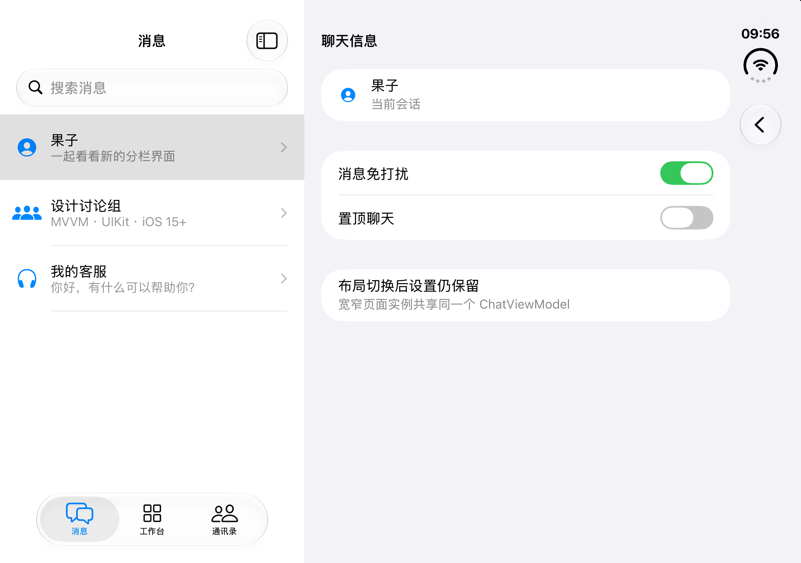

# Duo 开合验证：2026-11-04

## 环境与方法

- Xcode 27.2（Build 27B52），iPhone Duo Simulator / iOS 27.2。
- 被测 App 源码：`836510747283b8b4f745dcdf773724817850d7cc`。
- XcodeBuildMCP 重新构建、安装、启动成功；构建日志确认 `BUILD SUCCEEDED`。
- 通过当前 Xcode 的 Device Hub 操作 Closed / Partially Open / Open。旧 Simulator 前端缺少这组姿态控制，不能据此判定 Duo 无法开合。
- CUA 点击模拟器可访问元素；展开后的 Tab 子项未单独暴露时，根据当前截图点击 Tab。草稿通过可访问文本框 `setValue` 输入，每步再读取状态或截图确认结果。
- 使用 `simctl io <Duo-UDID> screenshot --display=1` 捕获外屏，`--display=3` 捕获内屏。截图是模拟器输出，不是设计稿。
- 同一 App 进程内完成下列序列，没有在步骤之间重新启动或重置 App。

## 复现步骤及观察值

| 步骤 | 操作 | 确认结果 |
| --- | --- | --- |
| 1 | Closed，消息选择果子，输入 `Duo-fold-draft-1104`；切 Open（姿态切换 1） | 左侧消息列表、三个 Tab；右侧果子聊天，`chat.draft` 为原文本 |
| 2 | 推入聊天信息，将 `info.muted` 打开；切 Closed（2） | 单栏聊天信息，免打扰为 `1`，Tab 隐藏 |
| 3 | 切 Open（3） | 左栏列表与 Tab 恢复；右侧仍为信息页，免打扰为 `1` |
| 4 | 左栏工作台 → 日程；切 Closed（4） | 单栏日程详情，带返回按钮 |
| 5 | 切 Open（5）→ 消息 | 工作台与日程先恢复；切消息后恢复果子信息页，免打扰为 `1` |
| 6 | 信息页返回聊天 | `chat.draft` 仍为 `Duo-fold-draft-1104` |
| 7 | 切 Closed（6），再返回列表 | 消息列表与三个 Tab 恢复，聊天已 pop |
| 8 | 切 Open（7） | 右侧为“选择一个项目”，没有复活已 pop 的详情 |
| 9 | 再选果子；更新草稿为 `Duo-keyboard-draft-1104` | 原草稿此前仍在，更新后显示新值 |
| 10 | 键盘显示时切 Partially Open（8） | 双栏保持，输入栏位于软件键盘上方，草稿可见 |
| 11 | 切 Closed（9）→ Open（10） | 折叠时键盘收起；两种布局的 `chat.draft` 均为更新后的值 |
| 12 | 选择设计讨论组，输入 `Team-only-draft`；回果子 | 果子仍为 `Duo-keyboard-draft-1104`，两个草稿隔离 |
| 13 | 发送果子草稿；切 Closed（11）→ Open（12） | 消息列表显示已发送文本，草稿为空；发送内容没有恢复为草稿 |
| 14 | 再选设计讨论组 | `chat.draft` 为 `Team-only-draft`，没有果子的发送内容 |
| 15 | 通讯录 → 小林；切 Closed（13）→ Open（14） | 单栏小林详情、双栏通讯录与小林详情分别正确，选中 Tab 保持 |
| 16 | 切回消息 | 恢复设计讨论组聊天，`chat.draft` 为 `Team-only-draft` |

结果：上述路径均符合预期。此次没有修改 App 或测试源码；新增文档与截图用于补齐真实 Duo 姿态切换证据。不将这轮 UI 操作计为 XCTest 测试通过数量。

## 截图

| 证据 | 对应状态 |
| --- | --- |
| [折叠聊天信息](duo-closed-info.png) | 步骤 2，免打扰保留、Tab 隐藏 |
| [展开聊天信息](duo-open-info.png) | 步骤 3，左侧 Tab + 列表、右侧独立信息页 |
| [返回列表后展开](duo-open-popped-list.png) | 步骤 8，已 pop 的聊天没有复活 |
| [半展开与键盘](duo-partial-keyboard.png) | 步骤 10，输入栏在键盘上方 |
| [开合后恢复草稿](duo-open-restored-draft.png) | 步骤 11，更新后的草稿保留 |
| [发送后再次展开](duo-open-sent-message.png) | 步骤 13，消息保留、草稿为空 |
| [通讯录开合后](duo-open-contacts.png) | 步骤 15，通讯录 Tab、选中联系人和详情保持 |

## 未覆盖

未覆盖取消交互式返回手势、动画过程中高频开合/点击、全部窗口尺寸、长消息列表滚动锚点、Dynamic Type、进程终止与持久化恢复、真机和 iOS 15 runtime。此次连续操作等待界面稳定后再进行下一步，不构成动画时序压力测试。键盘焦点按当前设计不恢复。
